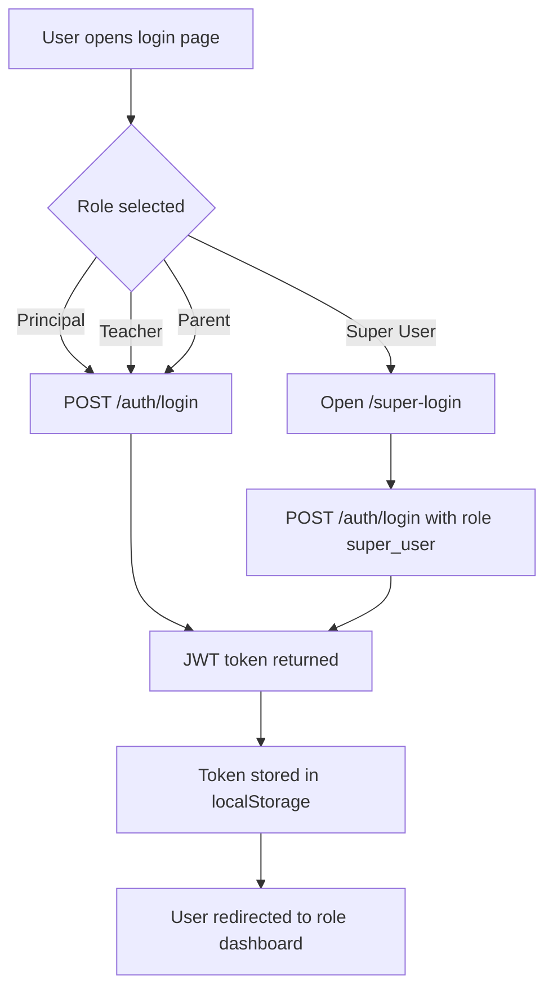
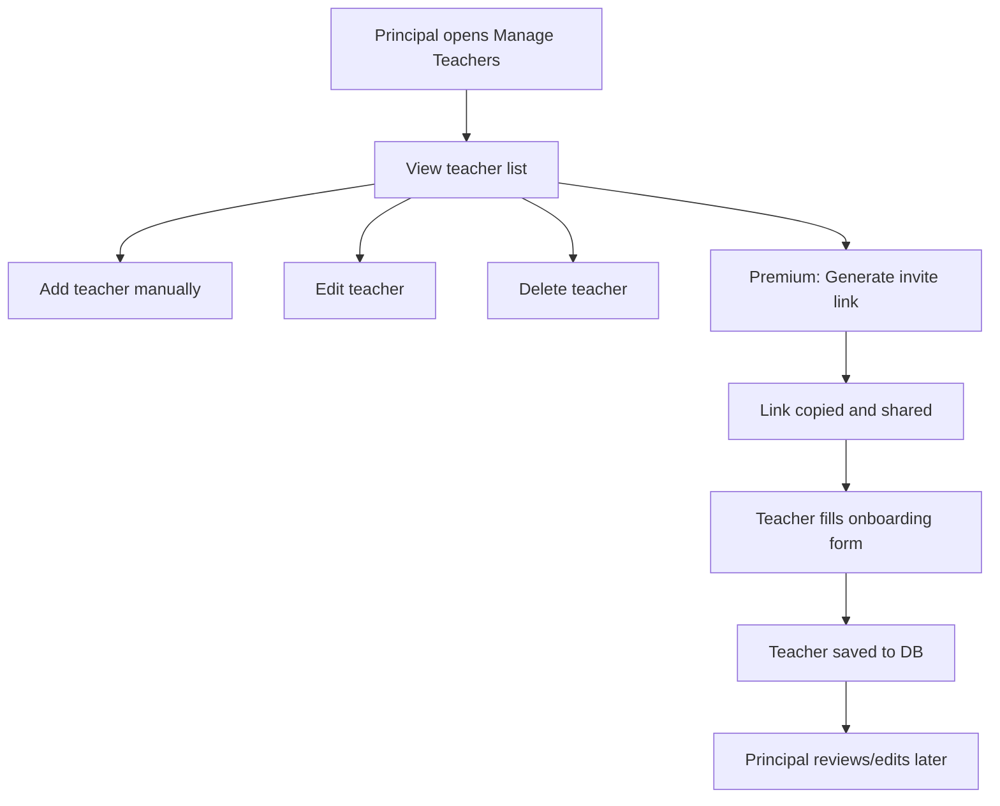
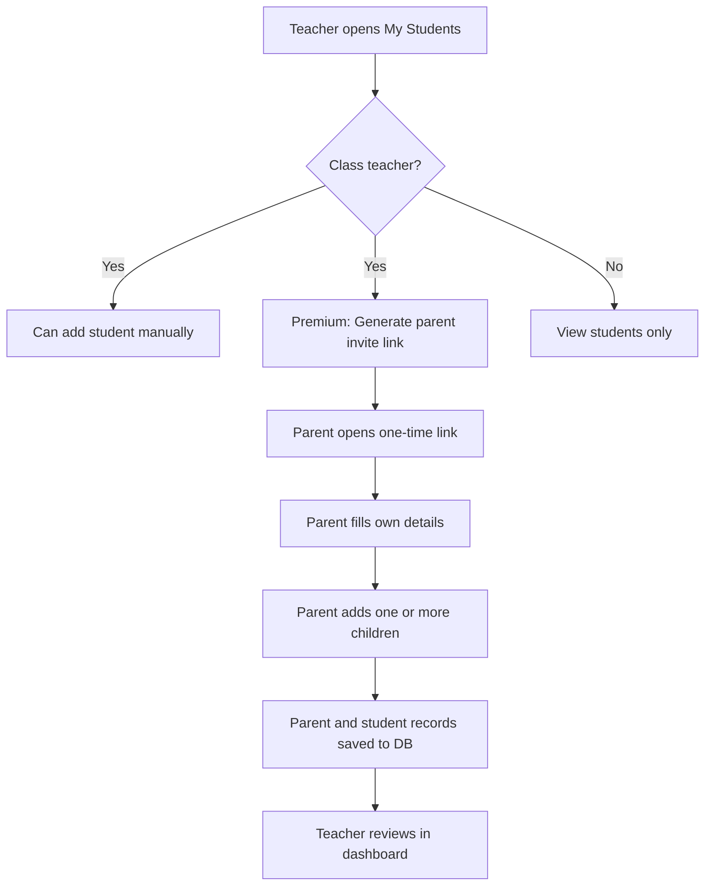
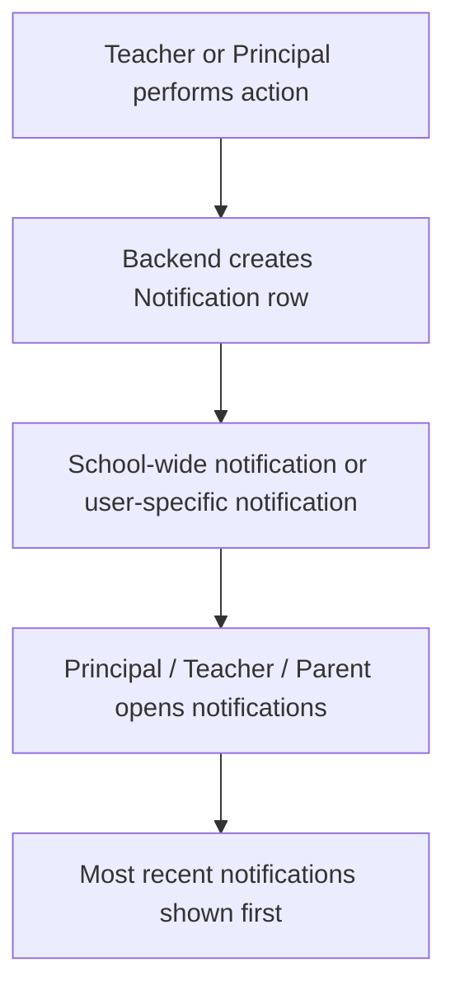
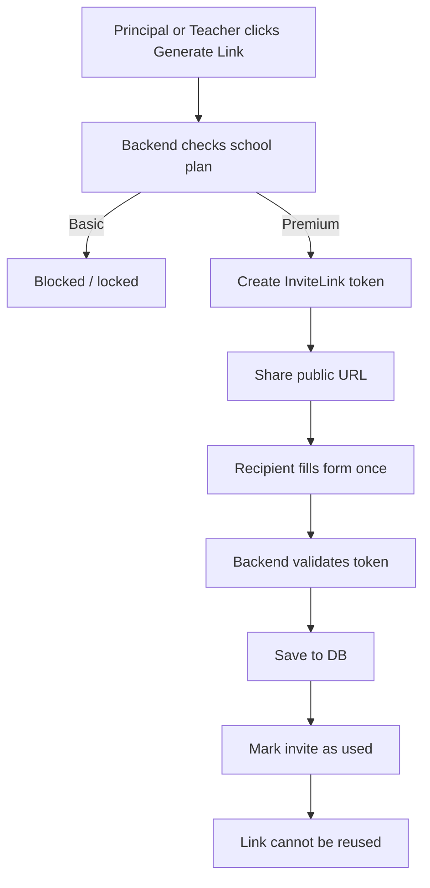
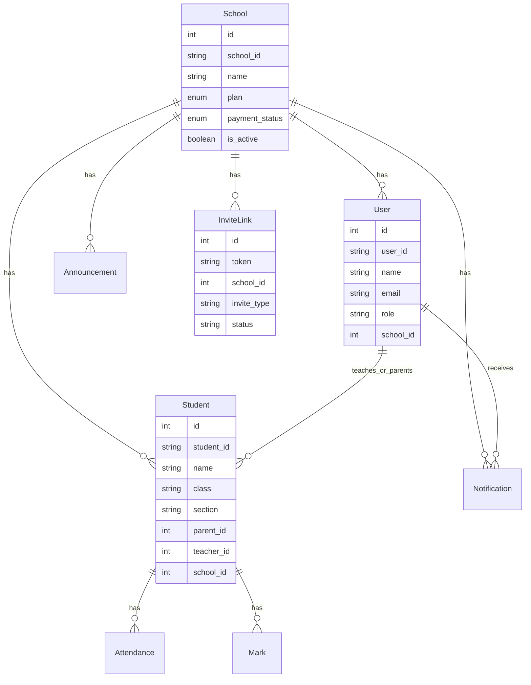

# EduManage Project Documentation

## 1. Project Overview

**Project Name:** EduManage
**Type:** Smart School Analytics and Management System
**Architecture:** React frontend + Node.js/Express backend + MySQL database
**Primary Users:** Principal, Teacher, Parent, Super User
**Plans:** Basic and Premium

EduManage is a multi-role school management platform designed to bring principals, teachers, parents, and platform administrators into one connected workflow. It helps schools manage student records, attendance, marks, fees, notifications, communication, timetable planning, and onboarding.

The platform supports:

- School-level management for principals
- Classroom-level workflows for teachers
- Child tracking for parents
- Platform-wide control for super admin
- Premium-only advanced features like analytics, chat, part-wise marks, and self-onboarding invite links

---

## 2. Why This Project Exists

Schools often struggle with:

- Manual teacher and student data entry
- Separate systems for attendance, marks, fees, and notifications
- Weak parent engagement
- No clear school-level analytics
- No easy workflow for scaling onboarding

EduManage solves this by providing one role-based platform where operational work, analytics, communication, and onboarding all happen in one place.

---

## 3. Value Proposition

### For Schools

- Centralizes academics, operations, fees, and communication
- Reduces manual administrative work
- Improves visibility across staff and students
- Helps scale school data management with invite-based onboarding

### For Principals

- One dashboard for school performance and operations
- Easy teacher/student management
- Better visibility into fees, marks, attendance, and staff activity
- Premium invite links reduce repetitive data entry

### For Teachers

- Daily classroom workflow for attendance and marks
- Access to assigned students
- Timetable and communication support
- Premium parent onboarding links simplify family/student profile collection

### For Parents

- One portal to track attendance, marks, fees, notifications, and timetable
- Premium chat with teachers
- Easier profile creation through one-time onboarding links

### For Platform Owner / Super User

- Central control of schools, plans, and subscriptions
- Manage school upgrades/downgrades
- Send platform-priority notifications

---

## 4. Product Pitch

### What

EduManage is a school operating system that combines management, communication, and analytics in one platform.

### Why

Because schools need speed, visibility, and structured workflows without depending on manual spreadsheets and scattered communication.

### How

By using role-based portals, plan-based feature control, and centralized data stored in MySQL through a secure backend API.

### When

EduManage is useful:

- during school onboarding
- for daily attendance and marks work
- for fee follow-up and parent communication
- for school-level reviews and analytics
- when scaling teacher and parent/student onboarding

---

## 5. Roles and Access

### Principal Login

- URL: `/login`
- Role selected: `principal`
- Main responsibilities:
  - manage teachers
  - manage students
  - view school dashboard
  - review notifications
  - analytics
  - fee tracking
  - board room / announcements
  - attendance oversight

### Teacher Login

- URL: `/login`
- Role selected: `teacher`
- Main responsibilities:
  - mark attendance
  - upload marks
  - view assigned students
  - manage class students if class teacher
  - view notifications
  - manage timetable
  - premium chat
  - premium parent onboarding invite links

### Parent Login

- URL: `/login`
- Role selected: `parent`
- Main responsibilities:
  - view child details
  - marks
  - attendance
  - fees
  - timetable
  - notifications
  - premium chat

### Super User Login

- URL: `/super-login`
- Separate from normal school login
- Main responsibilities:
  - platform control center
  - school subscription management
  - plan changes
  - platform-wide notifications
  - school-level inspection

---

## 6. Plans: Basic vs Premium

### Basic Plan

Includes:

- student limit up to 500
- total marks workflow
- school dashboard
- attendance management
- teacher management
- student management
- fee tracking
- notifications
- timetable basics

Locked in Basic:

- part-wise marks
- advanced analytics
- AI features
- individual comparison
- AI announcements
- attendance insights
- chat room
- self-onboarding invite links

### Premium Plan

Includes everything in Basic plus:

- student limit up to 1500
- part-wise marks upload
- advanced analytics
- AI-ready premium workflows
- attendance insights
- parent-teacher chat room
- self-onboarding invite links

### Premium Self-Onboarding Invite Links

Premium users can:

- principal generates one-time teacher onboarding link
- teacher generates one-time parent onboarding link
- submitted data is stored in DB
- link becomes invalid after one submission

---

## 7. Main Workflows

## 7.1 Authentication Workflow



## 7.2 Principal Teacher Management Workflow



## 7.3 Teacher Student / Parent Workflow



## 7.4 Notifications Workflow



## 7.5 Premium Invite Link Workflow



---

## 8. Frontend Structure

## 8.1 Tech Stack

- React
- React Router
- Axios
- Tailwind utility classes + legacy CSS
- Recharts
- Lucide icons

## 8.2 Frontend Responsibilities

- role-based login UI
- dashboards and data views
- feature locking by plan
- premium invite link generation UI
- public onboarding forms
- route protection
- token persistence in localStorage

## 8.3 Important Frontend Routes

### Public

- `/`
- `/login`
- `/super-login`
- `/payment`
- `/invite/teacher/:token`
- `/invite/parent/:token`

### Principal

- `/dashboard/principal`
- `/dashboard/principal/students`
- `/dashboard/principal/teachers`
- `/dashboard/principal/attendance`
- `/dashboard/principal/marks`
- `/dashboard/principal/fees`
- `/dashboard/principal/boardroom`
- `/dashboard/principal/analytics`
- `/dashboard/principal/notifications`

### Teacher

- `/dashboard/teacher`
- `/dashboard/teacher/attendance`
- `/dashboard/teacher/marks`
- `/dashboard/teacher/students`
- `/dashboard/teacher/timetable`
- `/dashboard/teacher/chat`
- `/dashboard/teacher/notifications`

### Parent

- `/dashboard/parent`
- `/dashboard/parent/student-details`
- `/dashboard/parent/marks`
- `/dashboard/parent/attendance`
- `/dashboard/parent/fees`
- `/dashboard/parent/timetable`
- `/dashboard/parent/chat`
- `/dashboard/parent/notifications`

### Super User

- `/dashboard/super`
- `/dashboard/super/schools`
- `/dashboard/super/notifications`

## 8.4 Frontend Auth Flow

- Login response returns token and user payload
- Token stored in `localStorage`
- User object stored in `localStorage`
- Protected routes check:
  - token/user exists
  - role matches route

---

## 9. Backend Structure

## 9.1 Tech Stack

- Node.js
- Express
- Sequelize
- MySQL
- JWT
- bcryptjs

## 9.2 Backend Responsibilities

- authentication
- role authorization
- CRUD for teachers, students, notifications, marks, attendance
- dashboard aggregation
- premium feature checks
- one-time invite link generation and submission

## 9.3 Backend Routing Overview

### Auth

- `POST /api/auth/register`
- `POST /api/auth/payment`
- `POST /api/auth/login`

### Invite APIs

- `POST /api/principal/teacher-invite-links`
- `POST /api/teacher/parent-invite-links`
- `GET /api/invite/teacher/:token`
- `POST /api/invite/teacher/:token/submit`
- `GET /api/invite/parent/:token`
- `POST /api/invite/parent/:token/submit`

### Principal APIs

- dashboard
- teachers CRUD
- students CRUD
- fee update
- notifications
- announcements
- analytics

### Teacher APIs

- dashboard
- class students
- add class student
- attendance
- marks
- timetable
- notifications
- premium chat

### Parent APIs

- dashboard
- child details
- marks
- attendance
- fees
- timetable
- notifications
- premium chat

### Super User APIs

- school summaries
- plan updates
- platform notifications

---

## 10. Database / SQL Layer

## 10.1 Database Type

- MySQL
- Connected through Sequelize ORM

## 10.2 Important Tables / Models

### `School`

Stores:

- school id
- school name
- plan
- payment status
- active status
- plan expiry
- subscription status

### `User`

Stores:

- principal
- teacher
- parent
- super user is virtual/auth-config based, not normal DB user

Important fields:

- `role`
- `subject`
- `section`
- `teacher_type`
- `school_id`

### `Student`

Stores:

- student profile
- class / section
- parent linkage
- teacher linkage
- fee status
- child personal details

### `Notification`

Stores:

- title
- message
- type
- category
- priority
- source role
- optional target user

### `Attendance`

Stores student attendance entries.

### `Mark`

Stores marks records by exam type and subject.

### `Announcement`

Stores principal announcements.

### `InviteLink`

Stores premium one-time onboarding links.

Fields:

- token
- school_id
- created_by_user_id
- created_by_role
- invite_type
- status
- expires_at
- used_at

## 10.3 Simplified ER Diagram



---

## 11. Premium Invite Link Design

## 11.1 Teacher Invite

Principal generates link. Teacher fills:

- name
- email
- password
- class teacher assignment
- section
- multiple handling classes
- multiple subjects

System behavior:

- available only for premium schools
- one-time use
- saved as teacher user record
- principal can edit later

## 11.2 Parent Invite

Teacher generates link. Parent fills:

- parent name
- email
- phone
- password
- address
- one or more children

For each child:

- student name
- class
- section
- roll number
- admission number
- DOB
- gender
- blood group
- address

System behavior:

- available only for premium schools
- one-time use
- saved as parent + one or more students
- teacher/principal can review later

---

## 12. Role-by-Role Feature Summary

## 12.1 Principal Features

- login and school dashboard
- manage teachers
- manage students
- fee tracking
- attendance overview
- marks overview
- board room / announcements
- notifications
- analytics
- premium onboarding invite generation

## 12.2 Teacher Features

- teacher dashboard
- mark own attendance
- apply leave
- mark class attendance
- upload marks
- view assigned students
- class teacher student management
- notify parents for fee
- notifications
- timetable
- premium chat
- premium parent onboarding invite generation

## 12.3 Parent Features

- dashboard
- child details
- marks
- attendance
- fees
- timetable
- notifications
- leave requests
- premium chat

## 12.4 Super User Features

- separate login
- platform dashboard
- school directory
- plan management
- subscription status updates
- expiry monitoring
- platform priority notifications

---

## 13. Basic vs Premium Feature Matrix

| Feature | Basic | Premium |
|---|---|---|
| Principal dashboard | Yes | Yes |
| Teacher dashboard | Yes | Yes |
| Parent dashboard | Yes | Yes |
| Super user control center | Yes | Yes |
| Teacher management | Yes | Yes |
| Student management | Yes | Yes |
| Fee tracking | Yes | Yes |
| Notifications | Yes | Yes |
| Timetable | Yes | Yes |
| Total marks upload | Yes | Yes |
| Part-wise marks upload | No | Yes |
| Advanced analytics | No | Yes |
| Attendance insights | No | Yes |
| Parent-teacher chat | No | Yes |
| AI/advanced workflows | No | Yes |
| Self-onboarding invite links | No | Yes |
| Higher student limit | No | Yes |

---

## 14. Business Uses

EduManage can be used by:

- private schools
- premium schools with large enrollments
- school chains
- growing schools needing centralized admin tools
- institutions needing parent visibility
- school platforms managing multiple school subscriptions

---

## 15. Sales / Demo Pitch

### Short Pitch

EduManage is a smart school operating system that helps principals, teachers, and parents work together through one connected platform for attendance, marks, fees, notifications, onboarding, and analytics.

### Problem Pitch

Most schools lose time because teacher onboarding, student entry, fee follow-up, parent communication, and reporting are all handled manually or in disconnected tools.

### Solution Pitch

EduManage replaces those scattered workflows with one role-based system:

- principals control school operations
- teachers manage classroom execution
- parents stay informed
- super admin controls subscriptions and school-level oversight

### Premium Upsell Pitch

For schools that want more scale and automation, Premium unlocks:

- advanced analytics
- part-wise marks
- live chat
- attendance insights
- self-onboarding invite links that reduce manual entry work

---

## 16. Real Project Strengths

- Multi-role architecture
- Plan-based feature gating
- Public invite onboarding flow
- Dedicated super admin portal
- Clear school/platform separation
- Strong dashboard-driven UX
- Expandable backend structure

---

## 17. Future Improvements

Recommended next improvements:

- WhatsApp share integration
- invite history and revoke option
- export reports to PDF/Excel
- audit logs
- stronger admin approval workflow for self-submitted data
- public domain deployment for invite links
- school branding / white-label support

---

## 18. Deployment Notes

### Frontend

- React app
- can be hosted on Vercel, Netlify, or static hosting

### Backend

- Node/Express API
- can be hosted on Render, Railway, VPS, or cloud VM

### Database

- MySQL
- configured through environment variables

### Important for Invite Links

To make shared invite links work outside local machine, set:

```env
REACT_APP_PUBLIC_APP_URL=https://your-domain.com
```

Without this, generated links use `localhost`, which only works on the same computer.

---

## 19. Download / Sharing

This document is stored in the project at:

`docs/EDUMANAGE_PROJECT_DOCUMENTATION.md`

You can share or convert it to:

- PDF
- DOCX
- HTML
- presentation summary

---

## 20. Conclusion

EduManage is not just a dashboard project. It is a full school workflow system with:

- structured role-based operations
- premium feature monetization
- scalable onboarding
- communication workflows
- analytics-driven decision support
- centralized school and platform management

It is suitable both as:

- a working software product
- a college/final-year project
- a startup demo product
- a SaaS school management platform foundation

---

## 21. Detailed Setup and Run Guide

This section explains exactly how to install, configure, and run EduManage on a local machine.

## 21.1 Prerequisites

Install the following before running the project:

- Node.js `18+` recommended
- npm
- MySQL Server `8.x` recommended
- Optional: MySQL Workbench for importing the database visually

To verify installation:

```powershell
node -v
npm -v
mysql --version
```

If `mysql` is not recognized in terminal, MySQL may still be installed, but its CLI is not added to your system `PATH`. In that case, use MySQL Workbench or add MySQL to `PATH`.

## 21.2 Project Structure for Running

- `backend/` contains the Express API and MySQL/Sequelize logic
- `frontend/` contains the React application
- `backup.sql` is the database dump that can be imported into MySQL

## 21.3 Backend Environment Variables

The backend uses a `.env` file located at:

`backend/.env`

Current required variables:

```env
PORT=5000
DB_HOST=localhost
DB_USER=root
DB_PASSWORD=your_mysql_password
DB_NAME=school_mgmt
JWT_SECRET=your_jwt_secret
JWT_EXPIRES_IN=7d
```

Optional variables supported by the code:

```env
SUPER_USER_EMAIL=your_admin_email
SUPER_USER_PASSWORD=your_strong_password
SUPER_USER_NAME=Platform Owner
SEED_DEFAULT_PASSWORD=your_secure_seed_password
SEED_PRINCIPAL_EMAIL=principal@example.com
SEED_EXPECTED_PLAN=basic
REACT_APP_PUBLIC_APP_URL=http://localhost:3000
```

Notes:

- `PORT=5000` is important because the frontend API client points to `http://localhost:5000/api`
- `DB_NAME` must match the database you create in MySQL
- `JWT_SECRET` should be replaced with your own secure value in real deployments
- `REACT_APP_PUBLIC_APP_URL` matters for shareable invite links

## 21.4 Create the Database

Open MySQL and create the database:

```sql
CREATE DATABASE school_mgmt;
```

You can do this from:

- MySQL command line
- MySQL Workbench
- phpMyAdmin if you use a local stack

## 21.5 Import Existing Data from `backup.sql`

If you want the project to start with existing data instead of a blank database, import `backup.sql`.

### Option A: Using MySQL command line

Run from the project root:

```powershell
mysql -u root -p school_mgmt < backup.sql
```

Then enter your MySQL password when prompted.

### Option B: Using MySQL Workbench

1. Open MySQL Workbench.
2. Connect to your local MySQL server.
3. Select the `school_mgmt` database.
4. Use the import or SQL execution option.
5. Open `backup.sql`.
6. Execute the script fully.

If you do not import `backup.sql`, the backend will still create tables automatically through Sequelize when the server starts, but the database will be mostly empty.

## 21.6 Install Backend Dependencies

Open a terminal in the project root and run:

```powershell
cd backend
npm install
```

Main backend packages used:

- `express`
- `sequelize`
- `mysql2`
- `bcryptjs`
- `jsonwebtoken`
- `cors`
- `dotenv`
- `nodemon`

## 21.7 Install Frontend Dependencies

Open another terminal and run:

```powershell
cd frontend
npm install
```

Main frontend packages used:

- `react`
- `react-router-dom`
- `axios`
- `tailwindcss`
- `framer-motion`
- `recharts`
- `lucide-react`

## 21.8 Start the Backend

From the `backend` folder:

```powershell
npm run dev
```

Or for normal Node execution:

```powershell
npm start
```

Expected result:

- backend connects to MySQL
- missing columns are added where needed
- API starts on `http://localhost:5000`

You should see logs similar to:

- `MySQL connected and tables synced`
- `Server running on http://localhost:5000`

## 21.9 Start the Frontend

From the `frontend` folder:

```powershell
npm start
```

Expected result:

- React dev server starts on `http://localhost:3000`
- browser opens the EduManage landing page

## 21.10 Correct Startup Order

Use this order to avoid API connection issues:

1. Start MySQL server
2. Start backend from `backend/`
3. Start frontend from `frontend/`
4. Open `http://localhost:3000`

## 21.11 Default Local URLs

- Frontend: `http://localhost:3000`
- Backend API root: `http://localhost:5000`
- Backend API base used by frontend: `http://localhost:5000/api`

## 21.12 Login and First Use

### Normal School Users

The normal login page is:

`/login`

Roles supported there:

- principal
- teacher
- parent

### Super User

The super admin login page is:

`/super-login`

### Super Admin Credentials

There are no default super admin credentials. Configure
`SUPER_USER_EMAIL` and `SUPER_USER_PASSWORD` in the backend `.env` file
before attempting to log in.

### Important Activation Note

For principal accounts created through registration, the school account must be active before login works. The backend checks whether the school is activated after payment.

If login fails with account activation errors, complete the payment flow through the app or update the school record accordingly in the database.

## 21.13 Optional Seed Commands

The backend includes helper scripts for demo data and plan cloning.

Run these from `backend/`:

```powershell
npm run seed:basic-demo
```

```powershell
npm run seed:premium-clone
```

Additional script available in the repo:

```powershell
node scripts/syncFullClassCoverage.js
```

Seed-related environment variables supported:

```env
SEED_DEFAULT_PASSWORD=your_secure_seed_password
SEED_PRINCIPAL_EMAIL=principal@example.com
SEED_EXPECTED_PLAN=basic
```

Use these scripts only when you understand the target database state, especially if the database already contains live or manually entered data.

## 21.14 Invite Link Configuration

Invite links are built from the frontend public URL logic.

For local-only testing:

```env
REACT_APP_PUBLIC_APP_URL=http://localhost:3000
```

For real device sharing, use a real domain or tunnel URL:

```env
REACT_APP_PUBLIC_APP_URL=https://your-domain.com
```

Without this, links may use `localhost`, which will not open properly on other devices.

## 21.15 Recommended Local Run Workflow

Use two terminals:

### Terminal 1

```powershell
cd c:\Users\swarn\Desktop\projects\swar-stud-project\backend
npm run dev
```

### Terminal 2

```powershell
cd c:\Users\swarn\Desktop\projects\swar-stud-project\frontend
npm start
```

Then open:

`http://localhost:3000`

## 22. Troubleshooting Guide

### Problem: `DB connection failed`

Possible causes:

- MySQL server is not running
- wrong `DB_USER`, `DB_PASSWORD`, or `DB_NAME`
- database `school_mgmt` does not exist yet

Fix:

1. Start MySQL server
2. Verify `.env` values
3. Create the database manually if needed

### Problem: Frontend loads, but API calls fail

Possible causes:

- backend is not running
- backend is running on a different port
- frontend still points to `http://localhost:5000/api`

Fix:

1. Confirm backend is running on port `5000`
2. Confirm `backend/.env` uses `PORT=5000`
3. Restart frontend after backend changes

### Problem: `Account not activated. Complete payment first.`

Cause:

- the school record exists, but `is_active` is still false

Fix:

- complete the payment flow from the app
- or update the school activation state in the database for local testing

### Problem: Invite link opens only on the same machine

Cause:

- generated link uses `localhost`

Fix:

- set `REACT_APP_PUBLIC_APP_URL` to a deployed domain or tunnel URL

### Problem: `mysql` command is not recognized

Cause:

- MySQL CLI is not added to system `PATH`

Fix:

- use MySQL Workbench instead
- or add the MySQL `bin` directory to your system `PATH`

### Problem: Tables are missing

Cause:

- backend has not started successfully yet
- database import failed

Fix:

1. Start backend successfully
2. Check backend logs
3. Re-import `backup.sql` if needed

## 23. Quick Start Summary

If you want the shortest working path:

1. Install Node.js and MySQL
2. Create MySQL database `school_mgmt`
3. Configure `backend/.env`
4. Import `backup.sql` into `school_mgmt`
5. Run `npm install` inside `backend/`
6. Run `npm install` inside `frontend/`
7. Start backend with `npm run dev`
8. Start frontend with `npm start`
9. Open `http://localhost:3000`
